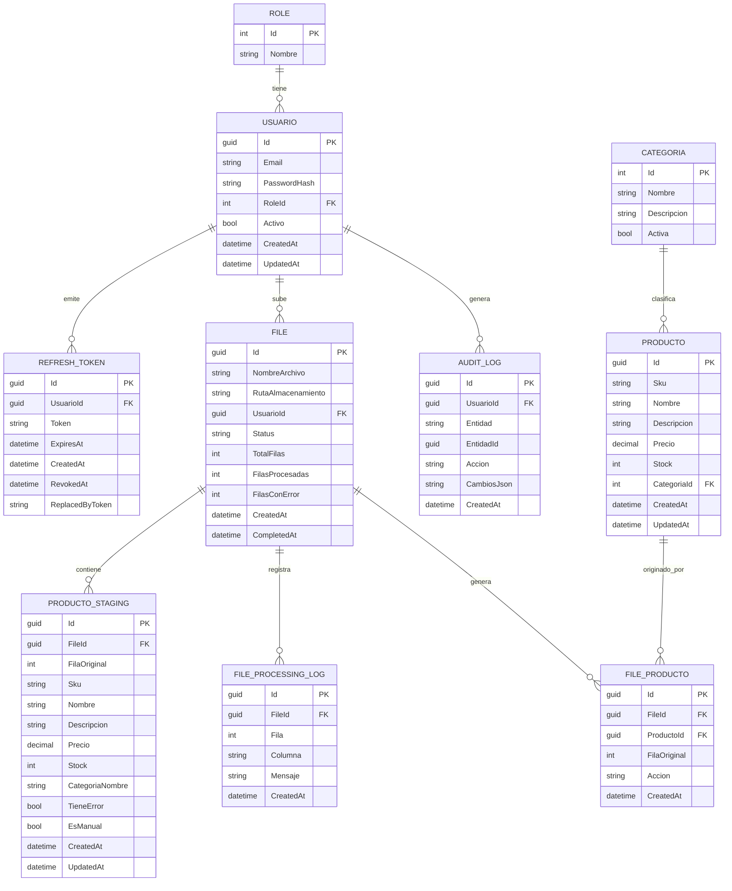

# ERD — Sistema de Catálogo de Productos

**Versión:** 0.1.0
**Relacionado:** [`spec.md`](./spec.md) §7, §9

Decisiones aplicadas en este diagrama (ver `spec.md` §7 para el razonamiento):

- `Usuario`–`Role` es **1:N** (FK `RoleId` en `Usuario`), no many-to-many.
- `ProductoStaging` es el área de trabajo editable pre-commit; `FileProducto` es el linaje post-commit (qué fila de qué archivo originó/actualizó qué producto definitivo). Son tablas distintas.
- `AuditLog` se modela pero queda sin UI de consumo en v0.1.

## Notas de implementación

- `FILE.Status` es un enum: `Pendiente | Procesando | Completado | Fallido | Parcial` (ver `spec.md` §5.2).
- `PRODUCTO.Sku` es único; el commit (`POST /files/{id}/commit`) hace upsert por `Sku` (ver `spec.md` §7.5).
- `PRODUCTO_STAGING` vive solo mientras el `File` está en `Pendiente`/`Procesando`/revisión; se purga (o se conserva solo para auditoría, a decidir en Fase 6) tras el commit o descarte.
- `FILE_PRODUCTO.Accion` registra `Creado` o `Actualizado`, para distinguir altas de modificaciones en el linaje.
- Índices recomendados: `PRODUCTO(Sku)` único, `PRODUCTO_STAGING(FileId)`, `FILE_PROCESSING_LOG(FileId)`, `REFRESH_TOKEN(Token)` único.
